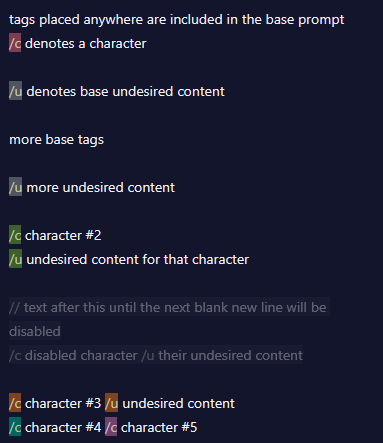
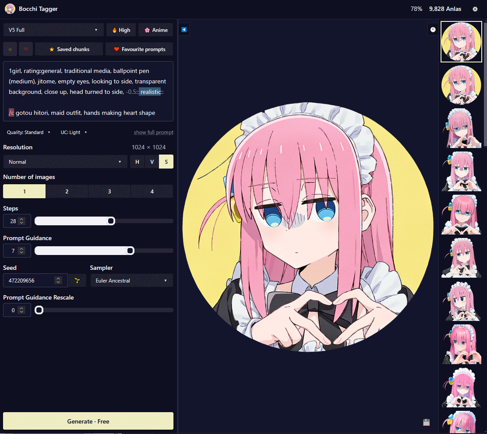
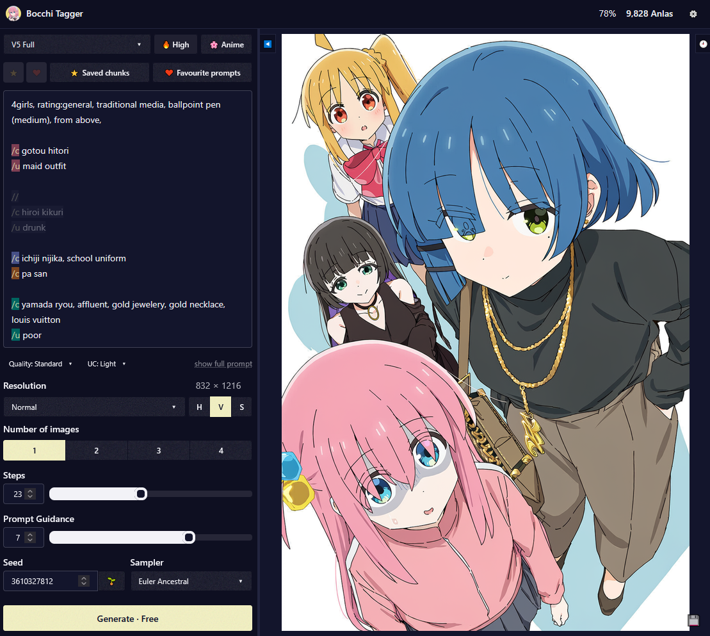

# Bocchi Tagger

Bocchi tagger is a web based client for NovelAI's image generation api which is intended to feel similar to the official image gen ui while making it easier to make quick edits to prompts and save chunks and favourite generations.

### Features
- Familiar UI and configuration settings
- Saved prompt chunks and favourite generations including their settings and seed
- A unique parser for labelling your prompts
- Ability to browse past generations

### Screenshots
Prompt box with `/c` `/u` and `//` syntax

Full interface

<!---->
